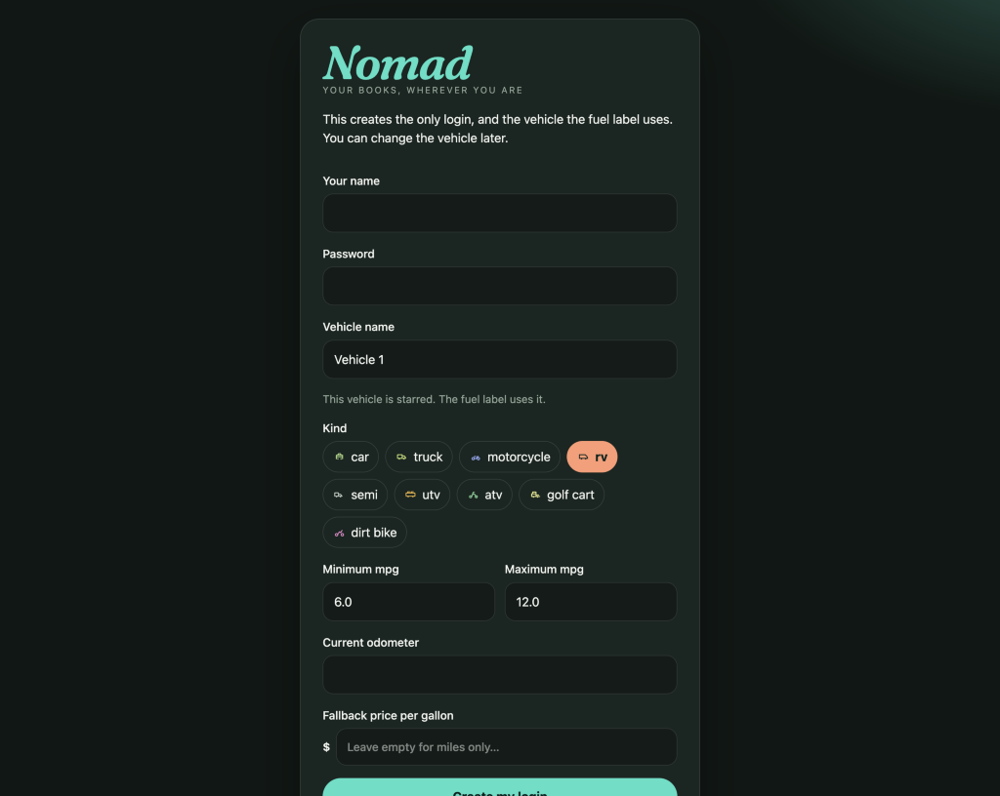
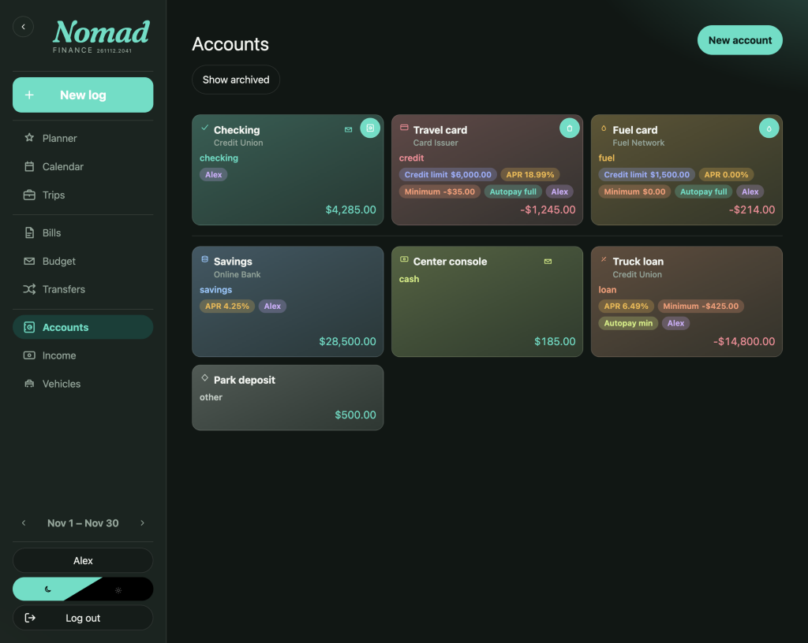
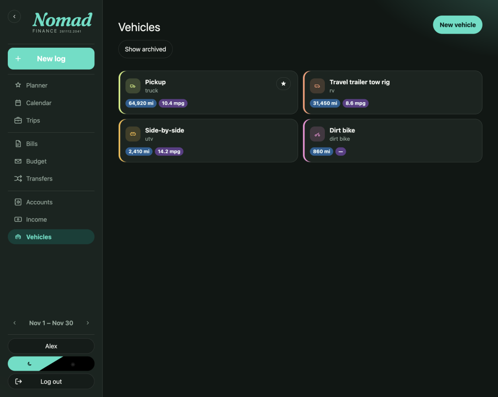
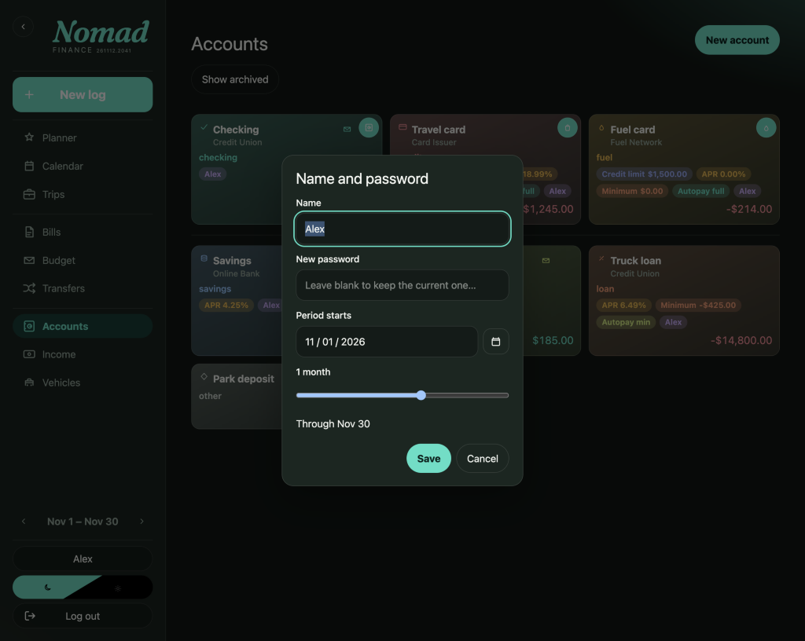
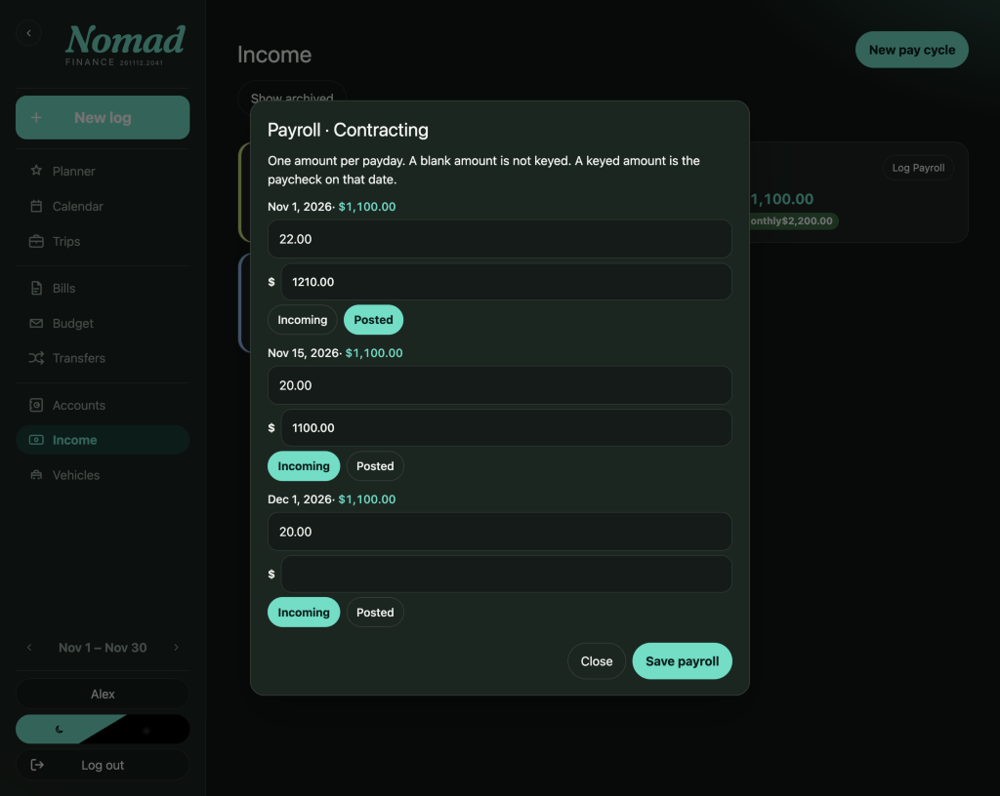
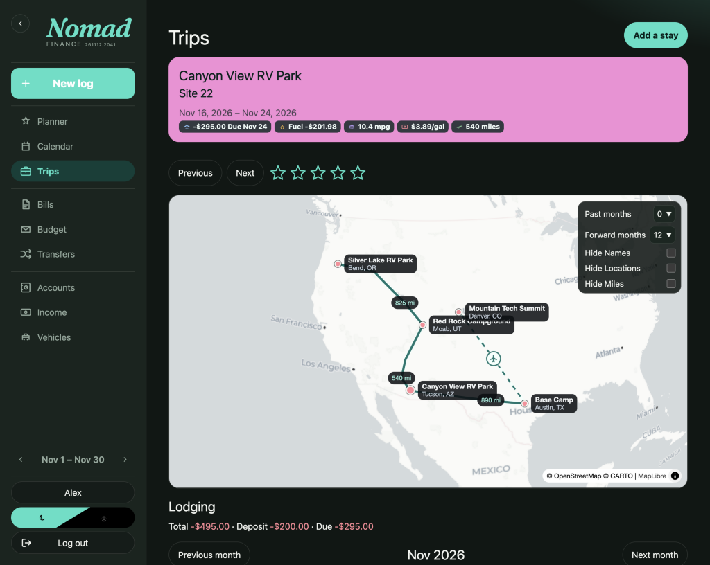
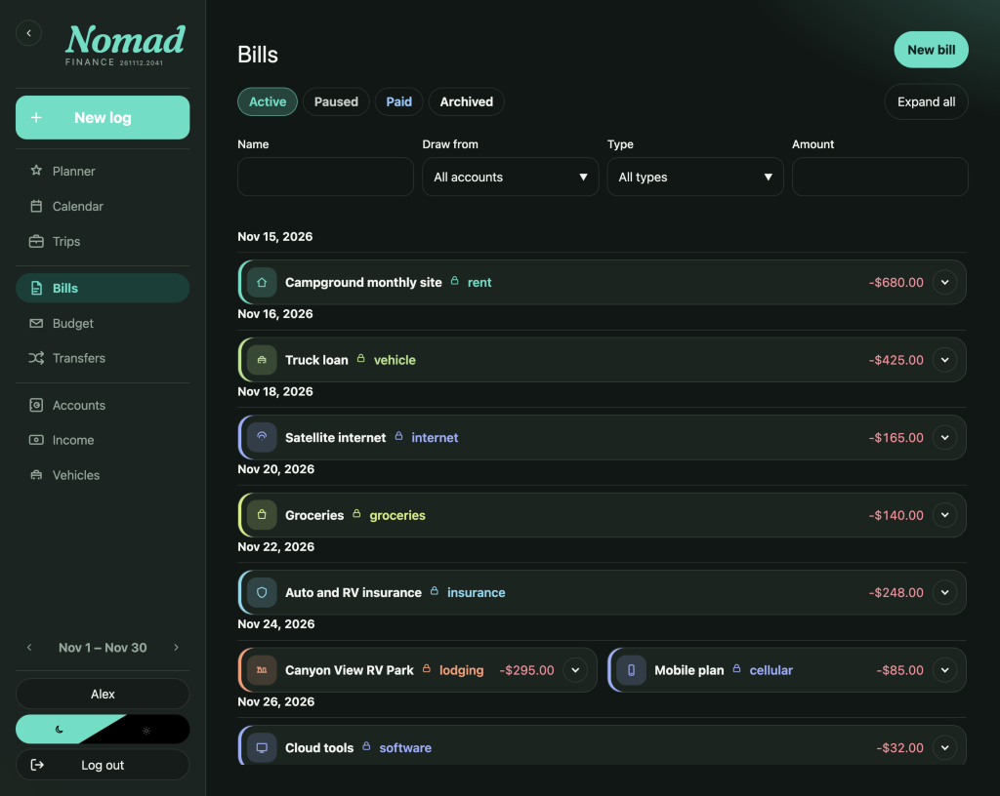
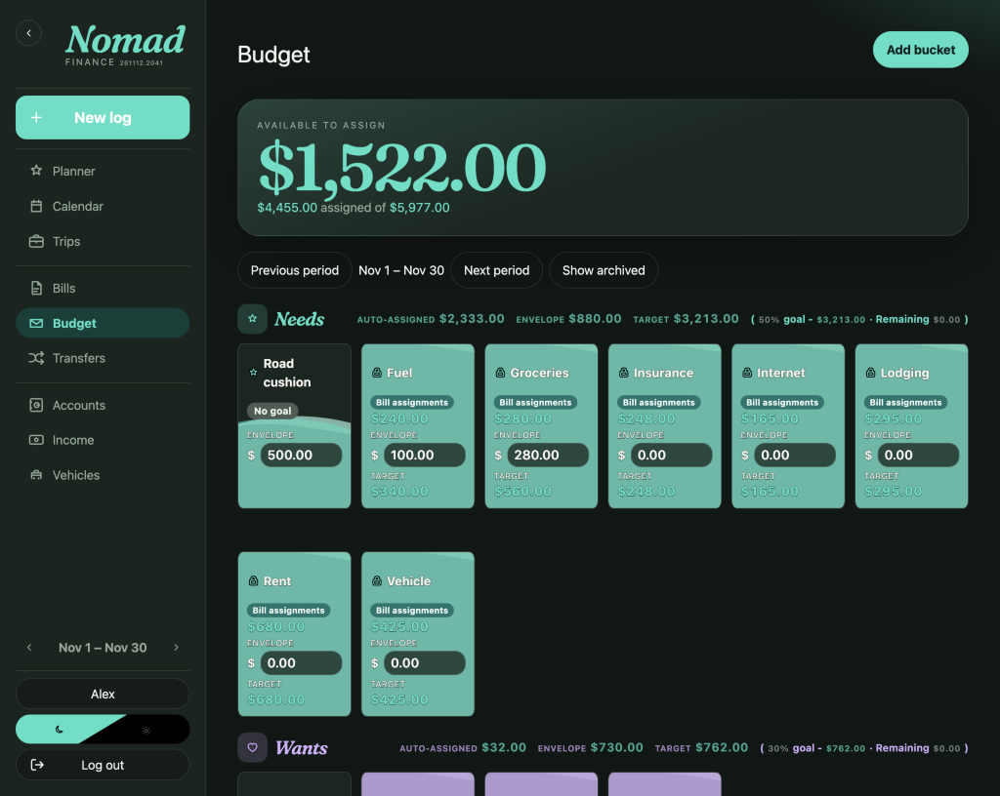
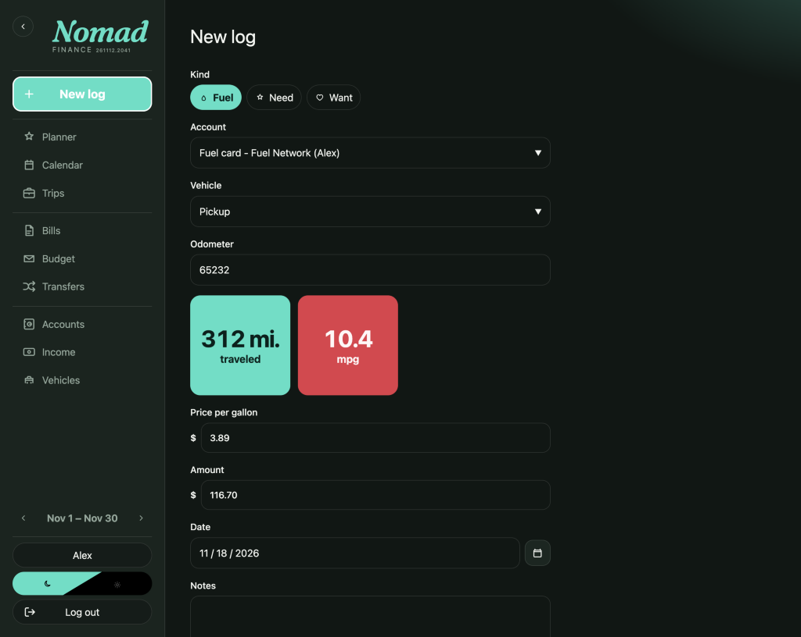

# Nomad Finance

A self-hosted personal finance app built for full-time travelers, RVers, and remote workers. Keep your accounts, bills, envelope budgets, pay cycles, vehicles, and travel stays together in one local SQLite database.

## Setup

When you open Nomad Finance for the first time, the setup screen creates your owner login and your primary vehicle. Enter your name, pick a password (at least 12 characters), choose a vehicle kind, set an expected MPG range, and type your current odometer reading. You can also enter an optional fallback price per gallon used to estimate trip fuel costs before your first fill-up is logged.



Setup also creates a separate `Demo` account pre-loaded with sample accounts, bills, pay cycles, vehicles, and stays. On future visits, click **Use demo** on the login screen (password: `demo-books-open`) if you want to test features without touching your own books.

## Getting Started

Once signed in, configure your accounts, vehicles, accounting period, and income so your budget and travel estimates have real numbers to work from.

### Accounts

Open **Accounts** to add your checking, savings, cash, credit, fuel, loan, and other accounts. Balances are typed directly rather than synced from a bank feed, and each card can track APR, credit limits, minimum due amounts, autopay settings, and account holders.

- Mark an asset as **Include in Budget** (envelope icon) to count its balance in your available budget pool. Leave savings or long-term deposits out so they still count toward net worth without inflating spending cash.
- Star default accounts for assets, shopping (credit), and fuel so new bills, transfers, and expense logs pre-select the right account.



### Vehicles

Open **Vehicles** to add any trucks, RVs, cars, motorcycles, UTVs, ATVs, golf carts, or dirt bikes you track fuel for. One vehicle can be starred as the active rig used for trip fuel estimates. As you log fill-ups, Nomad Finance calculates real MPG from consecutive odometer readings inside your configured min-max range and falls back to the range midpoint until enough fill-ups are recorded.



### User Settings and Accounting Period

Click your name in the bottom-left sidebar footer to open the settings dialog. From here you can update your display name, change your password, and set your **accounting period** start date and length (`1 week`, `2 weeks`, `4 weeks`, `1 month`, `2 months`, or `3 months`). The chosen accounting period drives Planner, Bills, Budget, and Income, and you can step backward or forward between periods from the sidebar controls.



### Income and Payroll

Open **Income** to set up pay cycles for each payor. Cycles support salary, fixed, and hourly pay across weekly, biweekly, semimonthly, monthly, and irregular schedules, plus an optional running average for variable paychecks.

Click **Log Payroll** on any payor card to record actual hours or paycheck amounts per payday and toggle each check between **Incoming** and **Posted**. Incoming checks dated inside the current accounting period count toward your available budget pool, while posted checks are assumed to already sit in your checking balance.



## Using the App

### Trips

Open **Trips** to plan stays and map your route on an interactive globe. Driving legs calculate road distance and fuel estimates using your starred vehicle's MPG and latest fuel price, while flights render as dashed arcs without adding fuel costs. Each stay can track arrival and departure dates, site notes, ratings, and lodging deposits or balances due, which automatically sync with your Bills and Budget screens.



### Bills

Open **Bills** to track one-time and repeating reminders across **Active**, **Paused**, **Paid**, and **Archived** tabs. Filter by name, account, bill type, or amount, and expand any bill to edit details, pause it, or mark it paid. Marking a regular bill paid records the occurrence and rolls the next due date forward without changing your typed account balances.



### Budget

Open **Budget** to assign your available cash across Needs, Wants, and Savings buckets for the current accounting period. Locked buckets automatically fill from upcoming bills and trip fuel estimates due in the period, and you can layer extra envelope amounts on top or create custom goal buckets with target balances or target dates. Paid-in-full credit and fuel cards automatically reserve uncovered card float so you always know what cash is truly free to assign.



### New Log

Click **+ New log** at the top of the sidebar to quickly record a **Fuel**, **Need**, or **Want** expense. Fuel logs calculate miles traveled and live MPG as you type your odometer reading, price per gallon, and total cost. Need and Want logs show a live preview of the matching bucket envelope so you can see how the purchase affects what is left before saving. Saving a log on a liability adds to the balance owed and keeps the bill open, while saving on an asset subtracts from the balance and marks the bill paid.



### Planner, Calendar, and Transfers

- **Planner**: Your home dashboard with customizable, resizable widgets for net worth and monthly interest, upcoming income, a multi-day calendar preview, current or upcoming trip map, account totals, budget progress, and upcoming bills. Drag widgets to reorder them or resize each card's width to fit your screen.
- **Calendar**: A full monthly grid showing stays, paydays, bill due dates, and custom calendar notes side by side. Click any day to inspect its items or add a multi-day note.
- **Transfers**: Move money between asset accounts or pay down a paid-in-full credit or fuel card. When paying a card, select the open bills covered by that payment so both account balances and bucket totals stay in sync.

## Developer Guide

### Tech Stack

- **Backend**: PHP 8.3+, Slim 4, PHP-DI, SQLite (PDO)
- **Frontend**: Svelte 5, TypeScript, Vite, Tailwind CSS, MapLibre GL
- **Tests**: PHPUnit (unit suite) and PHP WebDriver / Selenium (browser suite)

### Requirements

- PHP 8.3 or newer with `bcmath`, `json`, and `pdo_sqlite` extensions
- Composer
- Node.js 20 or newer and npm

### Installation and Local Development

Install PHP and frontend dependencies, then start the PHP backend:

```bash
composer install
npm install --prefix frontend
composer start
```

In a second terminal, start the Vite dev server:

```bash
npm run dev --prefix frontend
```

Open `http://127.0.0.1:5173`. PHP listens on `http://127.0.0.1:8080`, and Vite proxies `/api` requests to it.

The SQLite database is created automatically at `data/finance.sqlite` on first launch and is ignored by Git. Back it up by copying that file while the app is idle.

To restore the `Demo` user's sample books without affecting the owner's data:

```bash
composer demo:reset
```

### Building for Production

Compile the Svelte frontend into `public/build/` and serve the app directly from Slim:

```bash
npm run build --prefix frontend
composer start
```

Open `http://127.0.0.1:8080`.

#### Environment Variables

| Variable | Default | Description |
| --- | --- | --- |
| `FINANCE_DB` | `data/finance.sqlite` | Path to the SQLite database file |
| `FINANCE_NEW_USER` | unset (off) | Set to `1` or `true` to allow creating additional user logins from the login screen |
| `FINANCE_HOMEPAGE_TOKEN` | empty (off) | Shared secret enabling `GET /api/homepage/today` when passed in the `X-Homepage-Token` header |
| `FINANCE_HOMEPAGE_TZ` | `America/Los_Angeles` | IANA timezone used by `GET /api/homepage/today` to resolve today's calendar day |
| `VITE_CARTO_KEY` | empty | Optional CARTO basemap API key embedded at frontend build time |

Leave `FINANCE_NEW_USER` unset on any public host so visitors cannot register extra logins.

### Running Tests

Run the PHPUnit unit suite:

```bash
composer test
```

Rebuild the frontend after any `frontend/` changes and run the Selenium browser suite:

```bash
npm run build --prefix frontend
composer test:browser
```

Browser tests run against an isolated temporary SQLite file and never touch `data/finance.sqlite`. The first browser run downloads a matching ChromeDriver binary into `var/`.

### Maintainers and Guidelines

See [MAINTAINERS.md](MAINTAINERS.md) for maintainer information and project guidelines.
